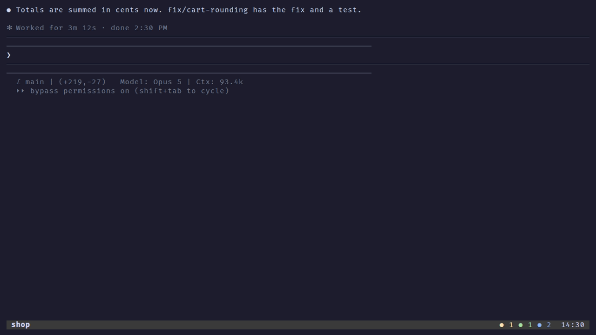

# agent-sidebar

A sidebar in tmux for the coding agents you run in it: Claude Code, Codex, OpenCode and Pi.

It lists every agent running in any tmux pane, grouped by project, with what each one is doing and which ones are waiting for you.
It follows you from window to window, and from it you jump to an agent, start a new one in a fresh git worktree, review its changes, open its pull request or kill it.
Agents get tools of their own: `agent-scan` to find one another, and `agent-msg` to send each other messages that are logged and can be verified.



<sub>The agents in it are stand-ins, from [`demo/`](demo/); `mise run demo` records it again.</sub>

## Requirements

- tmux 3.3 or newer
- [uv](https://docs.astral.sh/uv/) - the Python tools are uv scripts and fetch their own dependencies on first run
- [jq](https://jqlang.github.io/jq/) and git

Optional, each for the sidebar actions that use it:

- [television](https://github.com/alexpasmantier/television) (`tv`) - the projects picker (`o`) and the `tv agents` channel
- [lazygit](https://github.com/jesseduffield/lazygit) - `g`
- [gh](https://cli.github.com/) - pull request numbers and `p`
- [tuicr](https://github.com/agavra/tuicr) - reviewing an agent's changes (`d`)
- nvim - editing the settings (`s`)

## Install

With [TPM](https://github.com/tmux-plugins/tpm), add this to `~/.tmux.conf` and press `prefix` + `I`:

```tmux
set -g @plugin 'rogvid/agent-sidebar'
```

Without TPM, clone the repository and run its entry point from `~/.tmux.conf`:

```tmux
run-shell ~/path/to/agent-sidebar/agent-sidebar.tmux
```

Either way, the plugin also starts `agent-msg deliver --watch`, which pastes messages queued for an agent that could not take them yet, for as long as tmux runs.

Then, once, in a shell:

```bash
~/.tmux/plugins/agent-sidebar/bin/agent-sidebar-setup --check   # what it would change
~/.tmux/plugins/agent-sidebar/bin/agent-sidebar-setup
```

`agent-sidebar-setup` does what has to happen outside tmux, and is safe to run again:

- It links the tools into `~/.local/bin` (or `$XDG_BIN_HOME`), so the agents in your panes can run `agent-scan` and `agent-msg`, and you can run `git-wt`.
  tmux hands a new pane the `PATH` of the terminal it was opened from, so the plugin alone reaches only its own keys and hooks.
- It links the agent-sidebar skill into `~/.agents/skills` and into each Claude Code config folder (`~/.claude`, `~/.claude-*`), so agents know how to use `agent-scan` and `agent-msg`.
- It links the `agents` and `projects` channels into television's cable folder, when television is installed.
- It puts `agent-usage-tap` in front of each Claude Code statusline, in its `settings.json`, so the sidebar can show how much of each account's 5 hour and weekly limits is used.
  Claude Code hands those numbers only to its statusline.

Run it again after moving the plugin.
It leaves alone anything of your own in those places and says so.

Press `M-2` (Alt-2) to show the sidebar, and again to close it.

## Options

Set these in `~/.tmux.conf` before TPM runs:

```tmux
set -g @agent-sidebar-key M-s       # the key that shows and closes the sidebar (default M-2); off binds none
set -g @agent-sidebar-status off    # leave status-right alone (default: the agent counts go in front of it)
```

The status bar shows one coloured count per agent state, most urgent first, so you see an agent waiting for you while the sidebar is closed.
A theme plugin that sets `status-right` itself replaces it if the theme loads after agent-sidebar: list agent-sidebar after the theme, or turn the option off and put `#(agent-scan --tmux)` in your own `status-right`.

Everything else is in `~/.config/agent-sidebar/config.toml`: the sessions to leave out, the harnesses offered for a new worktree, the sidebar's width.
[`config.example.toml`](config.example.toml) lists every setting at its default, and `agent-sidebar-config check` says what is wrong with the file.

## Using it

In the sidebar, `?` lists every key and `ctrl+p` searches them.
The ones used most:

| Key | Does |
|-----|------|
| `⏎` | Jump to the agent |
| `n` | New git worktree with an agent in it |
| `o` | Open a project in its own tmux session |
| `d` | Review the agent's uncommitted changes |
| `g` / `p` | lazygit / the pull request, for the agent's branch |
| `x` / `X` | Kill the agent / remove its worktree too |
| `m` | Messages between agents |
| `R` | After a crash, start the agents of a recent save again, where they were |
| `q` | Close |

## The tools

All of them are in `bin/`: the plugin puts it on the `PATH` of tmux's keys and hooks, and `agent-sidebar-setup` links each tool into `~/.local/bin`.

| Tool | What it is |
|------|------------|
| `agent-sidebar` | The sidebar itself, a [Textual](https://github.com/Textualize/textual) app |
| `agent-sidebar-tmux` | Keeps the sidebar pane in the window you look at, and runs its actions |
| `agent-scan` | Finds the agents in tmux panes and works out their state; `--json` for scripts |
| `agent-msg` | Messages between agents, replies included, every one logged and verifiable, and queued until the recipient can take it |
| `agent-usage-tap` | Keeps each Claude account's rate limits for the sidebar |
| `agent-sidebar-config` | Reads and checks the settings file |
| `agent-sidebar-setup` | The setup above |
| `git-wt` | Git worktrees laid out one folder per branch, each with its own tmux session |
| `git-projects` | Lists your git repositories, most recently used first |
| `claude-worktree-create` | Claude Code's `WorktreeCreate` hook, through `git-wt` |

### Worktrees

`git-wt` keeps a project as a folder with the repository in `.bare` and one folder per branch beside it:

```
app/
  .bare/
  main/       # tmux session "app"
  feat-x/     # branch feat/x, tmux session "app-feat-x"
```

`git-wt clone URL` starts a project that way, and `git-wt --help` lists the rest.
The sidebar's new worktree (`n`) and remove worktree (`X`) use it, and plain clones still show up in the sidebar and the projects picker.

## Development

```bash
mise install     # the pinned tools
mise run hooks   # the prek hooks, once per clone
mise run test    # every test; the tmux ones start throwaway servers
mise run lint    # every hook on every file, as CI does
```

## License

[MIT](LICENSE)
